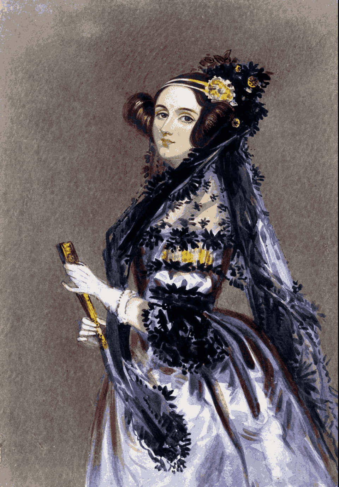
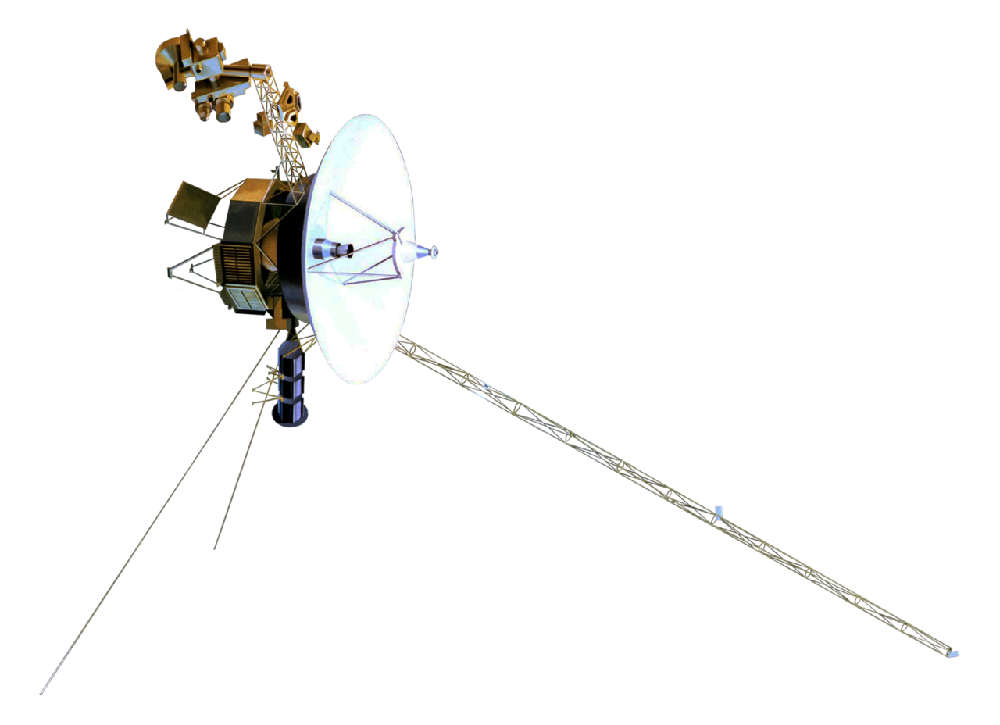

[← Volver al inicio](README.md)

# Temas del curso

### 16/09 · Mis aficiones

Llevo pinbtando desde que tengo 8 años. He ido a clases de pintura y de pintura textil hasta es año pasado. He pintado todo tipo de ropa y objetos ya que le puedes dar un toque muy personal a lo que quieras y hacer buenos regalos pero, lo que más me gusta es la tranquilidad que me transmite la actividad y poder aprender y superar mis propias pinturas y texturas. Me ayudaba mucho para desestresarme y aumentar mi creatividad.

Busacando en Github he encojntrado esto [lllyasviel](https://github.com/lllyasviel/style2paints.git)  
Una página donde encuentras herramientas para aprender

---

### 28/09 · Premios Princesa de Asturias: Leo Messi

Leo Messi es un futbolista argentino considerado uno de los grandes jugadores de la historia del fútbol. Ha ganado el **Premio Princesa de Asturias de los Deportes 2026**. El jurado le ha premiado por su extraordinario talento, su larga y exitosa trayectoria deportiva y, especialmente, por su labor solidaria para ayudar a niños desfavorecidos en educación y salud. También destacan su humildad, constancia y compromiso con el trabajo en equipo. **Yo lo he elegido** porque su trayectoria deportiva y su compromiso con los demás me parecen muy destacables.

[Leo Messi](https://www.fpa.es/es/premios-princesa-de-asturias/premiados/2026-leo-messi/?texto=acta)

Imagen: AUTOR, [Wikimedia Commons](https://commons.wikimedia.org/wiki/Category:Lionel_Messi)

### 13/10 · Ada Lovelace

Ada Lovelace fue una matemática y escritora británica. En 1843 tradujo un artículo sobre la Máquina Analítica de Charles Babbage y añadió notas que explicaban cómo podía seguir instrucciones para hacer cálculos y trabajar con símbolos. Por eso se la considera pionera de la programación, aunque algunos historiadores debaten si fue la primera, así lo muestran el Science Museum y un artículo académico. 
 El Día de Ada Lovelace celebra los logros de las mujeres en ciencia y tecnología y se celebra el segundo martes de octubre este año fue el 13.
Según la wikipedia [Ada Lovelace en Wikipedia](https://es.wikipedia.org/wiki/Ada_Lovelace)

{: width="300"}
*Cuadro de Ada. Imagen: E.Le Morvan, [Wikimedia Commons](https://commons.wikimedia.org/w/index.php?search=Ada+Lovelace&title=Special%3AMediaSearch&type=image)*

### 27/11/2026 · Voyager 1

La Voyager 1 es una sonda espacial de la NASA que se lanzó el 5 de septiembre de 1977. Su misión era explorar los planetas y estudiar el espacio. Actualmente sigue viajando fuera de nuestro sistema solar y es noticia porque continúa funcionando después de casi 50 años. Me parece increíble que pueda seguir enviando información a la Tierra desde una distancia tan enorme.

[Voyager 1 en Wikipedia](https://es.wikipedia.org/wiki/Voyager_1)

| Dato | Voyager 1 |
|---|---|
| Lanzamiento | 5 de septiembre de 1977 |
| Distancia a la Tierra | DATO EN KM |
| Velocidad | DATO EN KM/H |
| Lo que tarda su señal en llegar | DATO EN HORAS |
| Años de viaje | 49 años |

*La sonda espacial Voyager 1. Imagen: AUTOR, [Wikimedia Commons](ENLACE DE LA IMAGEN).*

**Mi Disco de Oro 2026**

- **Lo que pondría:** una fotografía de la Tierra desde el espacio y la canción «Viva la vida», de Coldplay.
- **En qué idioma:** español e inglés.
- **En qué formato:** imagen digital y archivo de audio.

---

